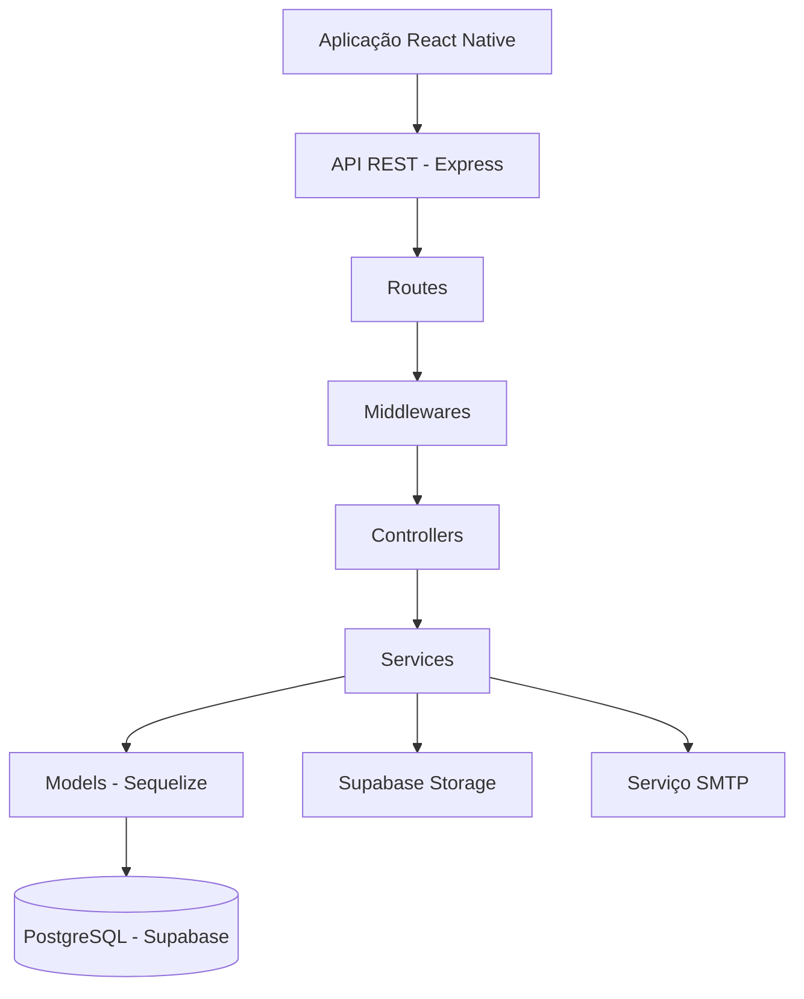

# InterChapecó — Backend

## 1. Sobre o projeto

O InterChapecó é uma aplicação móvel desenvolvida para
auxiliar estudantes de intercâmbio durante sua experiência
acadêmica e pessoal na cidade de Chapecó, Santa Catarina,
Brasil.

A aplicação reúne funcionalidades relacionadas à organização
do intercâmbio, controle financeiro, aprendizado do português,
exploração da cidade e interação entre estudantes.

O backend é responsável pelo gerenciamento dos dados,
autenticação, autorização, regras de negócio e comunicação
entre a aplicação móvel e o banco de dados.

O projeto foi desenvolvido como trabalho acadêmico da
disciplina de Desenvolvimento para Dispositivos Móveis
da Universidade Comunitária da Região de Chapecó
(Unochapecó).

## 2. Objetivos

- Centralizar informações úteis para estudantes de intercâmbio.
- Facilitar a organização de tarefas e despesas pessoais.
- Auxiliar na adaptação cultural e linguística.
- Promover a interação entre estudantes.
- Disponibilizar recursos para administração e moderação.
- Garantir a integridade e a proteção dos dados dos usuários.

## 3. Tecnologias utilizadas

| Tecnologia | Finalidade |
|---|---|
| Node.js | Ambiente de execução JavaScript |
| Express | Desenvolvimento da API REST |
| PostgreSQL | Banco de dados relacional |
| Supabase | Infraestrutura de banco de dados e armazenamento |
| Sequelize | ORM e gerenciamento dos modelos |
| JWT | Autenticação e controle de sessões |
| bcryptjs | Hash de senhas |
| Multer | Recebimento de imagens |
| Nodemailer | Envio de e-mails |
| dotenv | Gerenciamento de variáveis de ambiente |
| express-rate-limit | Limitação de solicitações |
| CORS | Configuração de acesso à API |
| Nodemon | Reinicialização durante o desenvolvimento |
| Git e GitHub | Controle de versão |
| ClickUp | Gerenciamento das atividades do projeto |

## 4. Arquitetura do sistema

O backend utiliza uma arquitetura em camadas, separando
as responsabilidades de comunicação, processamento,
validação e persistência dos dados.



### Routes

Definem os endpoints da API e os métodos HTTP disponíveis.

### Middlewares

Realizam verificações de autenticação, autorização,
limitação de solicitações e validação de arquivos enviados.

### Controllers

Recebem as solicitações HTTP, encaminham os dados aos
serviços e retornam as respostas ao cliente.

### Services

Contêm as regras de negócio, validações, operações de
banco de dados e integrações com serviços externos.

### Models

Representam as entidades do banco de dados e seus
relacionamentos por meio do Sequelize.

### Config

Contém as configurações de conexão com PostgreSQL
e Supabase.

### Utils

Contém funções auxiliares utilizadas por diferentes
módulos do sistema.

## 5. Estrutura do projeto

```text
INTERCHAPECO-BACKEND/
│
├── database/
│   └── migrations/
│       ├── 001_etapas_intercambio.sql
│       ├── 001_frases_iniciais.sql
│       ├── 002_orcamentos_mensais.sql
│       ├── 003_seguranca_frases.sql
│       ├── 004_seguranca_geral.sql
│       └── 004_traducoes_frases.sql
│
├── src/
│   ├── config/
│   │   ├── database.js
│   │   └── supabase.js
│   │
│   ├── controllers/
│   ├── middlewares/
│   ├── models/
│   ├── routes/
│   ├── services/
│   ├── utils/
│   └── app.js
│
├── .env.example
├── .gitignore
├── package.json
├── package-lock.json
└── server.js
```

## 6. Perfis de acesso

O sistema possui dois perfis de acesso.

### Estudante

Pode:

- Criar e acessar sua conta.
- Gerenciar seu perfil e preferências.
- Consultar lugares de Chapecó.
- Gerenciar tarefas do intercâmbio.
- Registrar despesas e definir orçamentos.
- Consultar frases em português.
- Publicar conselhos e comentários.
- Criar atividades.
- Curtir conselhos e demonstrar interesse em atividades.
- Gerenciar seus favoritos.

### Administrador

Pode:

- Consultar o painel administrativo.
- Gerenciar estudantes cadastrados.
- Ativar e desativar contas de estudantes.
- Gerenciar lugares e suas categorias.
- Gerenciar frases e suas categorias.
- Gerenciar categorias de conselhos e atividades.
- Moderar conselhos e atividades.
- Remover comentários inadequados.

As operações administrativas exigem autenticação
e autorização específica.

## 7. Módulos do sistema

### 7.1. Autenticação e perfil

Responsável pelo cadastro, login, recuperação de senha,
consulta e atualização dos dados pessoais.

O cadastro aceita a preferência inicial de idioma (`idioma`).
São aceitos `pt-BR`, `es` e `en`. Quando o campo é omitido,
o idioma padrão é `pt-BR`. Valores inválidos são rejeitados
com resposta HTTP 400. A preferência é persistida na conta.

As senhas são armazenadas utilizando bcrypt, com fator
de custo 10.

A autenticação é realizada por meio de tokens JWT,
com validade de 30 dias.

O aplicativo também realiza o encerramento local
da sessão e trata automaticamente sessões inválidas.

### 7.2. Início

Apresenta informações resumidas dos principais módulos,
incluindo tarefas, despesas, conselhos e atividades.

Os dados são obtidos pelo frontend por meio dos
endpoints dos respectivos módulos.

### 7.3. Explorar Chapecó

Permite consultar lugares da cidade organizados
por categorias.

Cada lugar pode conter:

- Nome.
- Descrição.
- Categoria.
- Endereço.
- Latitude e longitude.
- Imagem.

O aplicativo utiliza as coordenadas fornecidas pela API
para apresentar os lugares em mapas interativos.

A localização atual do estudante, o cálculo de distâncias
em linha reta pela fórmula de Haversine, a ordenação por
proximidade e a centralização do mapa são tratados no frontend.
As coordenadas atuais do dispositivo não são enviadas ao backend
para essas operações.

Os estudantes podem adicionar ou remover lugares
de seus favoritos.

### 7.4. Meu Intercâmbio

Permite criar, consultar, atualizar e excluir tarefas
relacionadas à experiência de intercâmbio.

As tarefas são organizadas em quatro etapas:

- Antes.
- Chegada.
- Durante.
- Retorno.

Os estados disponíveis são:

- A Fazer.
- Em Andamento.
- Concluído.

As prioridades disponíveis são:

- Baixa.
- Média.
- Alta.

Cada estudante possui acesso exclusivo às próprias tarefas.

### 7.5. Meus Gastos

Permite registrar e acompanhar despesas pessoais.

O módulo oferece:

- Cadastro de despesas.
- Consulta de despesas.
- Atualização de registros.
- Exclusão de despesas.
- Organização por categoria.
- Definição de orçamento mensal.
- Consulta do valor gasto.
- Consulta do saldo disponível.
- Estatísticas financeiras.
- Comparação entre períodos mensais.

As informações financeiras são individuais e acessíveis
somente ao usuário proprietário.

Os valores monetários são apresentados em reais (BRL).

### 7.6. Sobrevive em Português

Disponibiliza frases em português utilizadas em situações
comuns da vida cotidiana.

Cada frase contém:

- Texto em português.
- Traduções em espanhol e inglês.
- Contextos de utilização em espanhol, inglês e português.
- Categoria.

O estudante pode consultar frases e adicioná-las
aos favoritos.

A reprodução da pronúncia é realizada pelo aplicativo
móvel utilizando recursos de síntese de voz.

O administrador pode cadastrar, editar e desativar frases.
O cadastro de novas frases inclui os textos educativos nos
idiomas disponíveis. A pesquisa considera as expressões,
traduções e contextos armazenados. A seleção do texto exibido
é realizada pelo frontend.

### 7.7. Conselhos úteis

Permite compartilhar experiências, recomendações
e informações com outros estudantes.

O módulo oferece:

- Cadastro de conselhos.
- Consulta de publicações.
- Atualização de conselhos próprios.
- Exclusão de conselhos próprios.
- Organização por categoria.
- Inclusão de imagens.
- Curtidas.
- Comentários.

Somente o autor pode modificar seu conselho por meio
das operações destinadas aos estudantes.

O administrador pode moderar conteúdos inadequados.

### 7.8. Atividades e planos

Permite divulgar atividades acadêmicas, sociais,
culturais e de lazer.

Cada atividade pode conter:

- Nome.
- Descrição.
- Categoria.
- Data.
- Horário.
- Local.
- Coordenadas geográficas.
- Imagem.

Os estudantes podem publicar atividades, demonstrar
interesse e adicionar atividades aos favoritos.

As atividades vencidas deixam de aparecer na listagem
principal de atividades disponíveis.

### 7.9. Favoritos

Centraliza os conteúdos salvos pelo estudante.

Tipos de favoritos disponíveis:

- Lugares.
- Frases.
- Atividades.

Cada relação de favorito é associada ao usuário autenticado,
impedindo que a remoção de um favorito interfira nas
preferências de outros estudantes.

### 7.10. Configurações

Permite consultar e atualizar as preferências do usuário,
incluindo tema e idioma.

O sistema permite persistir e atualizar a preferência de idioma
da conta por meio dos endpoints de configurações.

Idiomas suportados pela interface:

- Português (pt-BR).
- Espanhol (es).
- Inglês (en).

O frontend utiliza dicionários e catálogos locais para traduzir
as interfaces dos módulos principais, inclusive as telas de acesso
e administração, e adaptar mensagens conhecidas, datas, valores
monetários, países e categorias ao idioma selecionado.

Antes do login, a preferência é mantida localmente no dispositivo.
Após a autenticação, prevalece a preferência persistida na conta.
O cadastro utiliza o idioma selecionado antes da autenticação.
O último idioma da interface é preservado após o logout.

O conteúdo das publicações dos estudantes não é traduzido
automaticamente pelo backend. A integração com serviços externos
de tradução automática de publicações não foi implementada.

### 7.11. Administração

O módulo administrativo centraliza a gestão dos usuários,
conteúdos e categorias.

O painel apresenta informações resumidas do sistema
e disponibiliza operações de gerenciamento e moderação.

A gestão de frases inclui as traduções em espanhol e inglês
e os contextos de utilização nos três idiomas.

## 8. Banco de dados

O sistema utiliza PostgreSQL, hospedado no Supabase.

O banco de dados é relacional e utiliza chaves primárias,
chaves estrangeiras e restrições de integridade.

O projeto possui 27 modelos de entidades.

| Grupo | Modelos |
|---|---|
| Usuários | Usuario, Rol, Pais, Universidade |
| Configurações e segurança | ConfiguracaoUsuario, TokenRecuperacaoSenha |
| Lugares | Lugar, CategoriaLugar, FavoritoLugar |
| Tarefas | Tarefa, EtapaIntercambio, EstadoTarefa, PrioridadeTarefa |
| Gastos | Gasto, CategoriaGasto, OrcamentoMensal |
| Frases | Frase, CategoriaFrase, FavoritoFrase |
| Conselhos | Conselho, CategoriaConselho, CurtidaConselho, ComentarioConselho |
| Atividades | Atividade, CategoriaAtividade, InteresseAtividade, FavoritoAtividade |

Os relacionamentos entre as entidades são definidos
no arquivo `src/models/index.js`.

### Relacionamentos principais

- Um usuário pode possuir várias tarefas.
- Um usuário pode possuir várias despesas.
- Um usuário pode possuir vários orçamentos mensais.
- Um usuário pode publicar vários conselhos.
- Um usuário pode publicar várias atividades.
- Um conselho pode possuir vários comentários.
- Um conselho pode receber várias curtidas.
- Uma atividade pode receber o interesse de vários usuários.
- Usuários podem salvar vários lugares, frases e atividades.
- As categorias organizam os registros dos respectivos módulos.

### Campos multilíngues das frases

A tabela `frases` mantém o conteúdo original em português, a
tradução em espanhol e o contexto existente em espanhol. A
migração `004_traducoes_frases.sql` adiciona os seguintes campos:

| Coluna PostgreSQL | Atributo Sequelize | Tipo | Finalidade |
|---|---|---|---|
| `traducao_ingles` | `traducaoIngles` | VARCHAR(300) | Tradução em inglês |
| `explicacao_ingles` | `explicacaoIngles` | TEXT | Contexto em inglês |
| `explicacao_portugues` | `explicacaoPortugues` | TEXT | Contexto em português |

A migração foi preparada para complementar as 71 frases
existentes no banco de dados do projeto, preservando seus
identificadores, textos originais e relações de favoritos.
Os novos campos são adicionados sem exigir valores para
todos os registros no momento da alteração da estrutura.

### Migrações

Os arquivos presentes em `database/migrations/` registram
alterações complementares realizadas no banco de dados.

Esses arquivos não constituem, isoladamente, um script
completo de criação do banco de dados desde o início.

A execução do projeto pressupõe um banco de dados
InterChapecó previamente configurado e autorizado.

## 9. API REST

### URL base

```text
http://localhost:3000
```

### Métodos HTTP

| Método | Finalidade |
|---|---|
| GET | Consultar registros |
| POST | Criar registros ou relações |
| PUT | Atualizar registros |
| PATCH | Atualizar parcialmente um registro |
| DELETE | Excluir registros ou relações |

### Códigos de resposta

| Código | Significado |
|---|---|
| 200 | Solicitação realizada com sucesso |
| 201 | Registro criado |
| 400 | Dados inválidos |
| 401 | Autenticação necessária ou sessão inválida |
| 403 | Acesso não autorizado |
| 404 | Registro não encontrado |
| 409 | Conflito de dados |
| 429 | Limite de solicitações excedido |
| 500 | Erro interno do servidor |

### Idioma das respostas

A API mantém os contratos JSON e as mensagens do servidor.
O frontend adapta as mensagens conhecidas ao idioma selecionado,
sem alterar os códigos HTTP ou os identificadores dos registros.
Não é necessário um serviço externo de tradução para essa operação.

### Autenticação das solicitações

Os endpoints protegidos exigem o envio do token JWT
no cabeçalho Authorization.

```http
Authorization: Bearer SEU_TOKEN_JWT
Content-Type: application/json
```

## 10. Principais endpoints

### 10.1. Autenticação

| Método | Endpoint | Finalidade |
|---|---|---|
| POST | `/auth/login` | Realizar login |
| POST | `/auth/cadastro` | Cadastrar estudante |
| POST | `/auth/recuperar-senha` | Solicitar recuperação |
| POST | `/auth/redefinir-senha` | Redefinir senha |
| GET | `/auth/me` | Consultar usuário autenticado |
| PUT | `/auth/me` | Atualizar perfil |
| PUT | `/auth/me/foto` | Atualizar fotografia |
| DELETE | `/auth/me/foto` | Remover fotografia |

O endpoint `POST /auth/cadastro` aceita o campo opcional
`idioma`, com os valores `pt-BR`, `es` ou `en`, além dos
demais dados exigidos pelo cadastro.

### 10.2. Configurações

| Método | Endpoint | Finalidade |
|---|---|---|
| GET | `/configuracoes/me` | Consultar preferências |
| PUT | `/configuracoes/me` | Atualizar preferências |

A atualização da preferência de idioma utiliza o campo `idioma`
no corpo da solicitação autenticada.

### 10.3. Lugares

| Método | Endpoint | Finalidade |
|---|---|---|
| GET | `/lugares` | Listar lugares ativos |
| GET | `/lugares/:id` | Consultar lugar |
| GET | `/favoritos/lugares` | Listar favoritos |
| GET | `/favoritos/lugares/:id` | Verificar favorito |
| POST | `/favoritos/lugares/:id` | Adicionar favorito |
| DELETE | `/favoritos/lugares/:id` | Remover favorito |

### 10.4. Tarefas

| Método | Endpoint | Finalidade |
|---|---|---|
| GET | `/tarefas` | Listar tarefas |
| POST | `/tarefas` | Criar tarefa |
| GET | `/tarefas/:id` | Consultar tarefa |
| PUT | `/tarefas/:id` | Atualizar tarefa |
| DELETE | `/tarefas/:id` | Excluir tarefa |
| PATCH | `/tarefas/:id/estado` | Atualizar estado |
| GET | `/tarefas/etapas` | Listar etapas |
| GET | `/tarefas/estados` | Listar estados |
| GET | `/tarefas/prioridades` | Listar prioridades |

### 10.5. Gastos

| Método | Endpoint | Finalidade |
|---|---|---|
| GET | `/gastos` | Listar despesas |
| POST | `/gastos` | Registrar despesa |
| GET | `/gastos/:id` | Consultar despesa |
| PUT | `/gastos/:id` | Atualizar despesa |
| DELETE | `/gastos/:id` | Excluir despesa |
| GET | `/gastos/categorias` | Listar categorias |
| GET | `/gastos/orcamento` | Consultar orçamento |
| PUT | `/gastos/orcamento` | Definir orçamento |
| GET | `/gastos/resumo` | Consultar resumo financeiro |
| GET | `/gastos/estatisticas` | Consultar estatísticas |

Os endpoints financeiros permitem consultar períodos
por meio dos parâmetros `ano` e `mes`, quando aplicável.

Exemplo:

```http
GET /gastos/resumo?ano=2026&mes=11
```

### 10.6. Frases

| Método | Endpoint | Finalidade |
|---|---|---|
| GET | `/frases` | Listar frases |
| GET | `/frases/:id` | Consultar frase |
| GET | `/frases/categorias` | Listar categorias |
| GET | `/favoritos/frases` | Listar favoritos |
| GET | `/favoritos/frases/:id` | Verificar favorito |
| POST | `/favoritos/frases/:id` | Adicionar favorito |
| DELETE | `/favoritos/frases/:id` | Remover favorito |

### 10.7. Conselhos

| Método | Endpoint | Finalidade |
|---|---|---|
| GET | `/conselhos` | Listar conselhos |
| POST | `/conselhos` | Publicar conselho |
| GET | `/conselhos/:id` | Consultar conselho |
| PUT | `/conselhos/:id` | Atualizar conselho |
| DELETE | `/conselhos/:id` | Excluir conselho |
| GET | `/categorias-conselho` | Listar categorias |
| GET | `/conselhos/:id/curtida` | Verificar curtida |
| POST | `/conselhos/:id/curtida` | Curtir conselho |
| DELETE | `/conselhos/:id/curtida` | Remover curtida |
| GET | `/conselhos/:id/comentarios` | Listar comentários |
| POST | `/conselhos/:id/comentarios` | Criar comentário |
| PUT | `/conselhos/:id/comentarios/:comentarioId` | Atualizar comentário |
| DELETE | `/conselhos/:id/comentarios/:comentarioId` | Excluir comentário |
| PUT | `/conselhos/:id/foto` | Atualizar imagem |
| DELETE | `/conselhos/:id/foto` | Remover imagem |

### 10.8. Atividades

| Método | Endpoint | Finalidade |
|---|---|---|
| GET | `/atividades` | Listar atividades |
| POST | `/atividades` | Publicar atividade |
| GET | `/atividades/:id` | Consultar atividade |
| PUT | `/atividades/:id` | Atualizar atividade |
| DELETE | `/atividades/:id` | Excluir atividade |
| GET | `/categorias-atividade` | Listar categorias |
| GET | `/atividades/:id/interesse` | Verificar interesse |
| POST | `/atividades/:id/interesse` | Registrar interesse |
| DELETE | `/atividades/:id/interesse` | Remover interesse |
| PUT | `/atividades/:id/foto` | Atualizar imagem |
| DELETE | `/atividades/:id/foto` | Remover imagem |
| GET | `/favoritos/atividades` | Listar favoritos |
| GET | `/favoritos/atividades/:id` | Verificar favorito |
| POST | `/favoritos/atividades/:id` | Adicionar favorito |
| DELETE | `/favoritos/atividades/:id` | Remover favorito |

### 10.9. Administração

| Método | Endpoint | Finalidade |
|---|---|---|
| GET | `/admin/acesso` | Verificar acesso administrativo |
| GET | `/admin/resumo` | Consultar painel |
| GET | `/admin/usuarios` | Listar usuários |
| GET | `/admin/usuarios/:id` | Consultar usuário |
| PATCH | `/admin/usuarios/:id/estado` | Alterar estado da conta |
| GET, POST | `/admin/lugares` | Listar e cadastrar lugares |
| GET, PUT, DELETE | `/admin/lugares/:id` | Gerenciar lugar |
| PUT, DELETE | `/admin/lugares/:id/foto` | Gerenciar imagem |
| GET, POST | `/admin/frases` | Listar e cadastrar frases |
| GET, PUT, DELETE | `/admin/frases/:id` | Gerenciar frase |
| GET, POST | `/admin/categorias-lugar` | Gerenciar categorias de lugares |
| GET, PUT, DELETE | `/admin/categorias-lugar/:id` | Gerenciar categoria |
| GET, POST | `/admin/categorias/:tipo` | Listar e criar categorias |
| GET, PUT, DELETE | `/admin/categorias/:tipo/:id` | Gerenciar categoria |
| GET | `/admin/moderacao/:tipo` | Listar conteúdos |
| GET | `/admin/moderacao/:tipo/:id` | Consultar conteúdo |
| PATCH | `/admin/moderacao/:tipo/:id/estado` | Moderar conteúdo |
| GET | `/admin/conselhos/:id/comentarios` | Consultar comentários |
| DELETE | `/admin/conselhos/:id/comentarios/:comentarioId` | Moderar comentário |

Os tipos de categorias disponíveis são `frases`,
`conselhos` e `atividades`.

Os tipos de moderação disponíveis são `conselhos`
e `atividades`.

## 11. Armazenamento de imagens

As imagens são armazenadas utilizando Supabase Storage.

O sistema permite o gerenciamento de fotografias
associadas a:

- Perfis de usuários.
- Lugares.
- Conselhos.
- Atividades.

O envio utiliza o formato `multipart/form-data`,
com o campo `foto`.

Formatos permitidos:

- JPEG.
- PNG.
- WEBP.

O limite de tamanho é de 5 MB por arquivo.

As operações de envio, atualização e remoção são
realizadas pelo backend, respeitando as permissões
do usuário autenticado.

## 12. Segurança

O projeto implementa as seguintes medidas:

- Autenticação utilizando JWT.
- Hash de senhas utilizando bcrypt.
- Controle de acesso por perfil.
- Validação da propriedade dos registros.
- Proteção de informações privadas.
- Validação dos dados recebidos.
- Limitação de tentativas de login.
- Limitação de solicitações de recuperação de senha.
- Tokens temporários de recuperação de senha.
- Invalidação de sessões após alterações relevantes
  na segurança da conta.
- Restrições de tamanho e formato de imagens.
- Utilização de variáveis de ambiente.
- Proteção de credenciais no controle de versão.
- Redução da exposição de informações sensíveis em logs.
- Configuração de Row Level Security (RLS) no Supabase.

O limite de login permite dez solicitações malsucedidas
por endereço IP em uma janela de quinze minutos.

O contador é mantido em memória e reiniciado quando
o servidor é reiniciado.

A aplicação foi desenvolvida para demonstração acadêmica
em ambiente local. Uma implantação em produção exigiria
configurações adicionais de infraestrutura e segurança.

## 13. Pré-requisitos

Para executar o backend, é necessário possuir:

- Node.js.
- npm.
- Git.
- Acesso autorizado ao banco de dados InterChapecó.
- Projeto Supabase configurado.
- Credenciais SMTP para recuperação de senha.

## 14. Instalação

### 14.1. Clonar o repositório

```bash
git clone https://github.com/Andres0606/backpruebas.git
```

### 14.2. Acessar o projeto

```bash
cd backpruebas/INTERCHAPECO-BACKEND
```

### 14.3. Instalar as dependências

```bash
npm ci
```

### 14.4. Configurar as variáveis de ambiente

Criar um arquivo `.env` a partir do arquivo `.env.example`.

No PowerShell:

```powershell
Copy-Item .env.example .env
```

No Linux ou macOS:

```bash
cp .env.example .env
```

Preencher as variáveis com as credenciais autorizadas.

```dotenv
PORT=3000

DATABASE_URL=

JWT_SECRET=

SUPABASE_URL=
SUPABASE_SERVICE_ROLE_KEY=

SMTP_HOST=
SMTP_PORT=465
SMTP_SECURE=true
SMTP_USER=
SMTP_PASS=
SMTP_FROM=
```

| Variável | Descrição |
|---|---|
| PORT | Porta do servidor |
| DATABASE_URL | String de conexão PostgreSQL |
| JWT_SECRET | Chave utilizada para assinar tokens JWT |
| SUPABASE_URL | URL do projeto Supabase |
| SUPABASE_SERVICE_ROLE_KEY | Credencial privada do backend |
| SMTP_HOST | Servidor de e-mail |
| SMTP_PORT | Porta SMTP |
| SMTP_SECURE | Configuração de segurança SMTP |
| SMTP_USER | Usuário SMTP |
| SMTP_PASS | Senha SMTP |
| SMTP_FROM | Remetente das mensagens |

As configurações SMTP devem corresponder ao provedor
de e-mail utilizado.

Nunca publicar o arquivo `.env` ou compartilhar
credenciais privadas no repositório.

## 15. Execução

### Modo de desenvolvimento

```bash
npm run dev
```

O Nodemon reinicia o servidor automaticamente
quando são realizadas alterações no código.

### Modo normal

```bash
npm start
```

O servidor estará disponível, considerando a porta padrão, em:

```text
http://localhost:3000
```

## 16. Integração com o aplicativo móvel

O frontend é desenvolvido em React Native com Expo
e comunica-se com o backend por meio de requisições HTTP.

Para o emulador Android, o endereço utilizado para acessar
o servidor executado no computador é:

```text
http://10.0.2.2:3000
```

O backend deve permanecer em execução durante
a utilização do aplicativo.

Em um dispositivo físico, a configuração da URL da API
deve utilizar um endereço acessível na rede local.

Repositório do frontend:

https://github.com/Andres0606/PROYECTO-DISPOSITIVOS-MOVEIS

## 17. Exemplo de utilização da API

### Realizar login

```http
POST /auth/login
Content-Type: application/json
```

Corpo da solicitação:

```json
{
  "email": "usuario@example.com",
  "senha": "SUA_SENHA"
}
```

A resposta de sucesso contém o token JWT
e os dados do usuário autenticado.

### Consultar usuário autenticado

```http
GET /auth/me
Authorization: Bearer SEU_TOKEN_JWT
```

### Atualizar o idioma da conta

```http
PUT /configuracoes/me
Authorization: Bearer SEU_TOKEN_JWT
Content-Type: application/json
```

```json
{
  "idioma": "es"
}
```

### Criar tarefa

```http
POST /tarefas
Authorization: Bearer SEU_TOKEN_JWT
Content-Type: application/json
```

Corpo da solicitação:

```json
{
  "titulo": "Organizar documentos",
  "descricao": "Preparar documentos do intercâmbio",
  "etapaId": "UUID_DA_ETAPA"
}
```

O identificador da etapa deve corresponder a um registro
existente no banco de dados.

## 18. Testes e validação

Durante o desenvolvimento foram realizadas verificações
funcionais e de integração, incluindo:

- Cadastro e autenticação.
- Persistência do idioma selecionado durante o cadastro.
- Consulta e atualização das preferências de idioma.
- Consulta de traduções e contextos das frases.
- Gerenciamento administrativo de frases multilíngues.
- Recuperação de senha.
- Expiração e invalidação de tokens.
- Operações de CRUD.
- Validação de propriedade dos registros.
- Controle de acesso administrativo.
- Independência de favoritos e interações.
- Gerenciamento de fotografias.
- Moderação de conteúdos.
- Proteção contra tentativas excessivas de login.
- Verificação de sintaxe JavaScript.
- Integração entre frontend, backend e banco de dados.

As verificações foram realizadas utilizando a aplicação
móvel, requisições HTTP e consultas ao banco de dados.

## 19. Gerenciamento do projeto

O desenvolvimento foi organizado por meio do ClickUp,
com distribuição de responsabilidades entre os integrantes,
acompanhamento das atividades e controle de progresso.

[ClickUp — InterChapecó](https://app.clickup.com/90171528938/v/li/901716947222)

O Git e o GitHub foram utilizados para o controle
de versão e acompanhamento das alterações do código.

## 20. Integrantes

- Andres Felipe Suarez Roa.
- Luciana Guillot.
- Sebastian Castaño.

## 21. Informações acadêmicas

**Instituição:** Unochapecó

**Curso:** Ciência da Computação

**Disciplina:** Desenvolvimento para Dispositivos Móveis

**Professor:** Marcos Antonio Moretto

**Ano:** 2026

---

InterChapecó — Aplicação de apoio à experiência
dos estudantes de intercâmbio em Chapecó.

Projeto desenvolvido para fins acadêmicos.